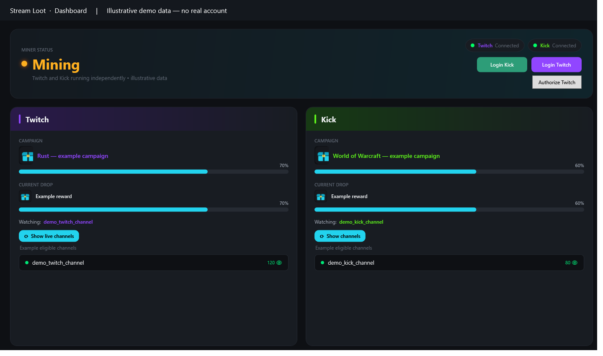
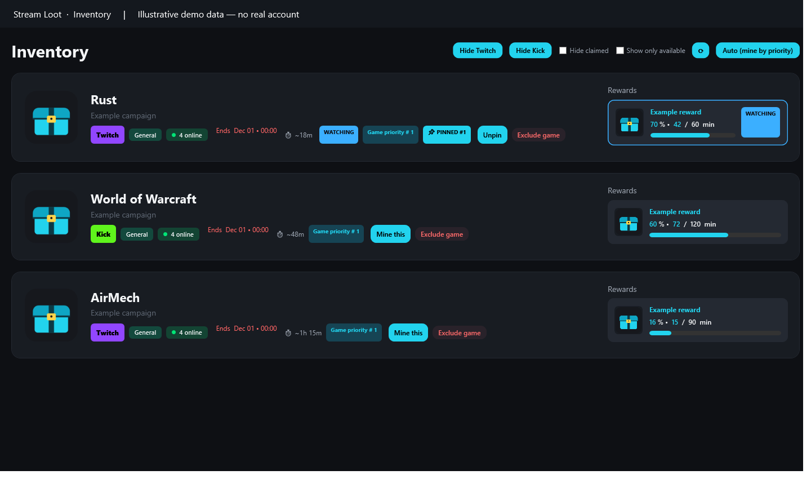

<div align="center">


# Stream Loot — Twitch & Kick Drops Miner for Windows

**A free, open-source desktop app for tracking Twitch Drops and Kick Drops, prioritizing games and automatically attempting reward claims.**

[**Download for Windows**](https://github.com/Reaxtic/StreamLoot/releases/latest) · [Getting started](#getting-started) · [FAQ](#faq) · [Po polsku](README.pl.md)

[](https://github.com/Reaxtic/StreamLoot/releases/latest)
[](LICENSE)
[](#requirements)
[](https://github.com/Reaxtic/StreamLoot/actions/workflows/release.yml)
[](https://github.com/Reaxtic/StreamLoot/stargazers)

If Stream Loot is useful to you, **[star the repository](https://github.com/Reaxtic/StreamLoot)** to bookmark it and help other players discover it. No subscription or paid unlock is required.

</div>



*Current interface, rendered with illustrative data. Example channels and progress are not a live mining result or a promise of rewards.*

## What is Stream Loot?

Stream Loot is a Twitch and Kick drops miner built in C# with .NET and WebView2. It runs on your Windows computer, finds eligible live channels, watches in the background and periodically reconciles progress with the platforms. Twitch and Kick are handled separately, so you can work toward drops on both platforms at the same time.

The project is a fork of [Stream Drop Collector](https://github.com/tsgsOFFICIAL/StreamDropCollector) by Marcus Jensen, with a redesigned interface and changes to campaign selection, progress tracking and recovery. It is distributed under the [MIT License](LICENSE), with the original copyright and attribution retained.

## Why use it?

- **Twitch and Kick in one app.** Separate campaign progress, watched channels and reward status for each platform.
- **Game priorities, not a rigid allow-list.** Put Rust before AirMech, for example. Unavailable priorities allow fallback; explicit game exclusions take precedence.
- **Pin a specific campaign.** An available manual pin takes precedence over game preferences. Offline pins do not need to block all other work.
- **Server-reconciled progress and automatic claim attempts.** A playing video or successful watch request is not treated as proof that a reward was credited or claimed.
- **Inventory controls.** Hide Twitch or Kick visually, filter claimed rewards, exclude games from campaign cards and click a game name to copy it.
- **Background recovery.** Playback checks, sleep/resume recovery and watchdog logic help recover interrupted sessions. They cannot guarantee continuous earning.
- **Free software, MIT licensed.** Read the source, modify it or redistribute it under the license terms. No subscription is required.



*Illustrative inventory data. Placeholder artwork explains the interface; campaigns shown here are not an availability list.*

## Getting started

1. Open the [latest Windows release](https://github.com/Reaxtic/StreamLoot/releases/latest).
2. Under **Assets**, download `StreamLoot-vX.Y.Z.zip`, not the GitHub-generated source archives.
3. Extract the ZIP to a writable folder and run **`Stream Loot.exe`**.
4. Sign in to Twitch and/or Kick in the embedded browser. Complete any authentication prompt yourself.
5. Set game priorities and exclusions in Settings, or pin a campaign from Inventory.

The release is self-contained: a separate .NET installation is not required. [Microsoft Edge WebView2 Runtime](https://developer.microsoft.com/en-us/microsoft-edge/webview2/) is required for the embedded browser. Keep the computer awake and connected to the internet while mining.

**Download only from [this repository's Releases page](https://github.com/Reaxtic/StreamLoot/releases).** There is no official paid edition or requirement to buy a license key.

## Requirements

- Windows 10 or 11, 64-bit, with Microsoft Edge WebView2 Runtime.
- A Twitch account, a Kick account, or both, with any required authentication completed.
- An active, eligible drop campaign and a qualifying live channel.
- Internet access and an awake computer. A tray icon does not mean the app can earn while Windows is asleep.

The current app is Windows-only. There is no supported Linux, macOS, Docker or headless server build.

## FAQ

### Is Stream Loot free? What does the MIT License allow?

Yes. The MIT License permits use, modification and redistribution, including commercial use, subject to its terms. Copies must retain the copyright and permission notice. The software comes without warranty. See the complete [LICENSE](LICENSE).

### Can it earn Twitch Drops and Kick Drops simultaneously?

It can run one watched channel per platform independently. Which rewards count, when progress appears and whether a claim succeeds are determined by Twitch, Kick and the campaign rules.

### Do I need to link my game account?

Check the campaign requirements. Some campaigns allow watch progress before a publisher account is linked, but claiming or receiving the reward may still require linking. Stream Loot does not bypass that requirement.

### Why is a drop not progressing?

Possible causes include an ineligible channel, an ended campaign, a disconnected session, paused playback, network problems or delayed platform reporting. Check the platform's own inventory first. If it also shows no progress, a moving player in Stream Loot is not evidence that minutes are being credited. [Report a reproducible issue](https://github.com/Reaxtic/StreamLoot/issues/new/choose) with the app version and redacted diagnostics.

### What wins: exclusions, pins or game priorities?

Exclusions win. Next come available manually pinned campaigns, followed by the configured game order and then other allowed campaigns. Unavailable choices permit fallback. Within a game-priority level, partially progressed rewards can be preferred by time remaining to the next drop.

### Does it work minimized, with a locked PC, or after sleep?

It is designed to run in the background while Windows remains awake and connected. Sleep suspends earning. Resume recovery is implemented, but browser sessions, drivers, remote-desktop changes and network conditions can still interrupt playback. Verify progress on the platforms rather than relying only on the app's Mining label.

### Where are my login sessions and settings stored?

The app uses local WebView2 browser profiles and local files, including `%APPDATA%\Stream Loot`. Login requests go to the respective platform. Update checks and downloads contact GitHub, and browser pages can load their own service and media domains. This is not an offline app.

Treat the entire WebView2 profile, saved tokens and diagnostic logs as sensitive. Never upload your app profile or unredacted logs. More guidance is in [SECURITY.md](SECURITY.md).

### Is it affiliated with Twitch or Kick? Is automated viewing allowed?

No affiliation, endorsement or guarantee is implied. Automated viewing may conflict with platform terms or campaign rules. Review the rules relevant to your accounts and use the app at your own risk. MIT licensing does not grant platform permission or guarantee account safety.

## Help improve Stream Loot

If the project helps you, [give it a GitHub star](https://github.com/Reaxtic/StreamLoot), share the repository with someone who needs it, or [report a bug](https://github.com/Reaxtic/StreamLoot/issues/new/choose). Useful reports and reproducible fixes are more valuable than inflated star counts.

Want to contribute code or documentation? Read [CONTRIBUTING.md](CONTRIBUTING.md). Want to share it in a community? The [promotion kit](docs/PROMOTION.md) contains short English and Polish descriptions, artwork and disclosure guidance. Follow each community's rules; do not spam or trade stars.

## Build from source

Install the [.NET 10 SDK](https://dotnet.microsoft.com/download) on Windows, then:

```powershell
git clone https://github.com/Reaxtic/StreamLoot.git
cd StreamLoot
dotnet publish UI/UI.csproj -c Release -r win-x64 --self-contained true
```

Output: `UI/bin/Release/net10.0-windows10.0.17763.0/win-x64/publish/`.

## License and credits

[MIT License](LICENSE). Original Stream Drop Collector © Marcus Jensen (tsgsOFFICIAL); Stream Loot modifications © Reaxtic. Keep these notices when redistributing the code.

The Twitch watch-signal approach and channel-picker ideas were informed by [TwitchDropsMiner](https://github.com/DevilXD/TwitchDropsMiner) by DevilXD. This project is a separate C#/.NET implementation, not a drop-in replacement or affiliated release.

Twitch, Kick, game names and reward artwork belong to their respective owners. See [CHANGELOG.md](CHANGELOG.md) for releases and the [earlier Polish development history](docs/HISTORIA_ZMIAN_PL.md).

## Buy me a coffee

If you'd like to support my work on Stream Loot, you can buy me a coffee. Donations are optional; the app remains free and MIT licensed.

[](https://ko-fi.com/reaxtic)
