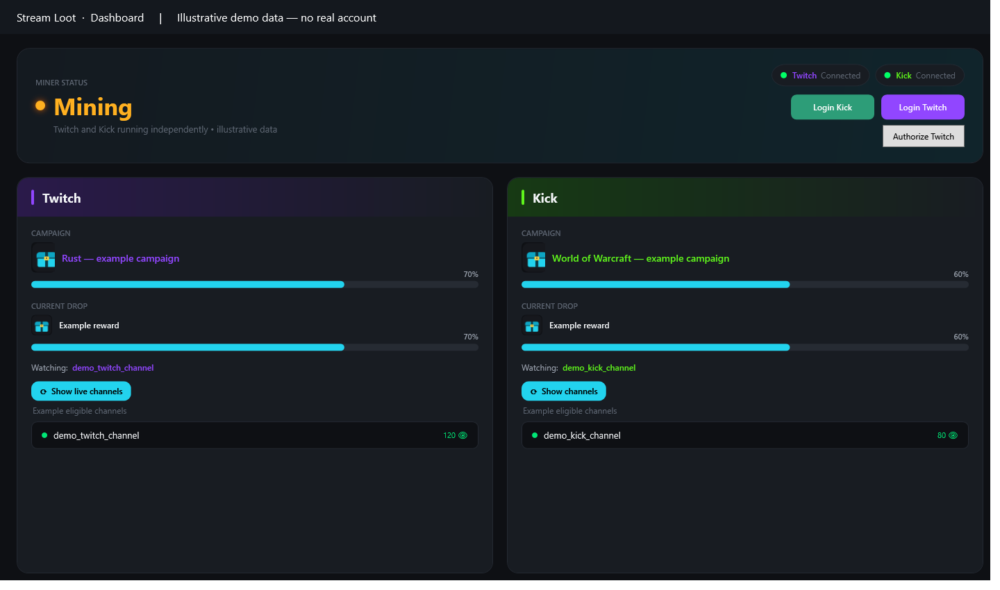

# Stream Loot — darmowy program do Twitch Drops i Kick Drops na Windows

Stream Loot to aplikacja open source, która śledzi kampanie Twitch i Kick, wybiera transmisje według priorytetów i automatycznie próbuje odbierać nagrody. Obie platformy działają niezależnie. Program jest dostępny bez abonamentu na [licencji MIT](LICENSE).

**[Pobierz wersję na Windows](https://github.com/Reaxtic/StreamLoot/releases/latest)** · [English](README.md) · [Zgłoś problem](https://github.com/Reaxtic/StreamLoot/issues/new/choose)

Jeśli program Ci się przydaje, [dodaj gwiazdkę na GitHubie](https://github.com/Reaxtic/StreamLoot). To pomaga innym znaleźć projekt i ułatwia powrót do jego strony.

*Aktualny interfejs z przykładowymi danymi. To prezentacja funkcji, nie potwierdzenie naliczania ani lista dostępnych kampanii.*

## Co oferuje program?

- Obsługę Twitch i Kick w jednym oknie, z osobnym postępem dla każdej platformy.
- Kolejność priorytetów gier, ręczne przypinanie kampanii i niezależne wykluczenia.
- Weryfikowanie postępu na serwerach oraz automatyczne próby odebrania nagród.
- Filtry ekwipunku, ukrywanie platform, wykluczanie gry z jej karty i kopiowanie nazwy kliknięciem.
- Działanie w tle, kontrolę odtwarzania i mechanizmy odzyskiwania po przerwaniu sesji.
- Kod źródłowy na MIT, bez wymaganej opłaty za korzystanie.

## Instalacja

1. Otwórz [najnowsze wydanie](https://github.com/Reaxtic/StreamLoot/releases/latest).
2. W sekcji **Assets** pobierz `StreamLoot-vX.Y.Z.zip`. Archiwa „Source code” zawierają kod, a nie gotowy program.
3. Rozpakuj paczkę i uruchom `Stream Loot.exe`.
4. Zaloguj się do Twitch lub Kick i samodzielnie przejdź wymagane uwierzytelnianie.
5. Ustaw priorytety gier albo przypnij konkretną kampanię w ekwipunku.

Wymagany jest Windows 10/11 x64 i [Microsoft Edge WebView2 Runtime](https://developer.microsoft.com/en-us/microsoft-edge/webview2/). Gotowa paczka zawiera środowisko .NET. Komputer musi być włączony, nieuśpiony i połączony z internetem. Obecna wersja nie obsługuje Linuksa ani Dockera.

## Najczęstsze pytania

**Czy MIT oznacza, że mogę zmieniać i udostępniać program?**

Tak, także komercyjnie, z zachowaniem warunków licencji, w tym informacji o prawach autorskich i treści zezwolenia. MIT nie daje gwarancji działania. Zachowane są informacje o autorze oryginału: Marcus Jensen, Stream Drop Collector, oraz modyfikacjach Reaxtic.

**Co ma pierwszeństwo przy kopaniu?**

Wykluczenia, potem dostępne ręcznie przypięte kampanie, następnie priorytety gier i pozostałe dozwolone kampanie. Niedostępna pozycja nie powinna blokować dostępnych nagród.

**Czy konto gry musi być połączone?**

Zależy od kampanii. Czasami postęp można zdobywać przed połączeniem konta wydawcy, ale odebranie lub otrzymanie nagrody nadal go wymaga. Program nie omija tych zasad.

**Dlaczego nie nalicza?**

Najpierw sprawdź ekwipunek na Twitch lub Kick. Sam status „Kopanie” i odtwarzanie filmu nie potwierdzają naliczania. Przyczyną może być niewłaściwy kanał, koniec kampanii, utrata sesji, problem z siecią lub opóźnienie raportowania. Do zgłoszenia dołącz wersję aplikacji i opis kroków, bez tokenów i danych logowania.

**Czy można zostawić program zminimalizowany?**

Tak, jest do tego przeznaczony. Uśpiony komputer nie zdobywa postępu. Po wybudzeniu program próbuje wznowić pracę, ale warto sprawdzić faktyczny postęp na platformie. Nie gwarantujemy nieprzerwanego naliczania ani bezpieczeństwa konta wobec zasad platform.

**Czy moje dane trafiają do autora programu?**

Sesje przeglądarki i ustawienia są przechowywane lokalnie. Logowanie wymaga komunikacji z platformami; aktualizacje są sprawdzane i pobierane z GitHuba. Strony w przeglądarce korzystają też z własnych domen usługowych i multimedialnych. Nie udostępniaj profili WebView2, zapisanych tokenów ani pełnych logów. Zobacz [zasady bezpiecznego zgłaszania](SECURITY.md).

## Pomóż znaleźć projekt innym

Gwiazdka, rzeczowe zgłoszenie błędu lub polecenie znajomemu pomagają w rozwoju. Przy udostępnianiu w społecznościach przestrzegaj ich regulaminu i ujawniaj, jeśli jesteś autorem lub współtwórcą. [Gotowe opisy i materiały](docs/PROMOTION.md) można dostosować do miejsca publikacji.

Stream Loot nie jest oficjalnym produktem Twitch ani Kick. Automatyzacja może być niezgodna z zasadami platform lub kampanii. Korzystasz na własne ryzyko. Licencja MIT dotyczy oprogramowania, a nie prawa do automatycznego zdobywania nagród.

[Pełna dokumentacja po angielsku](README.md) · [Historia wydań](CHANGELOG.md) · [Kod i współpraca](CONTRIBUTING.md)
